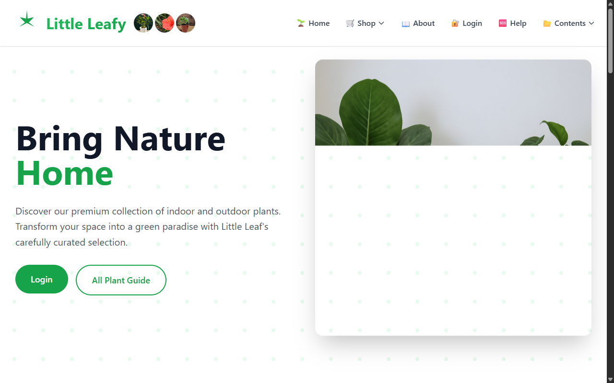
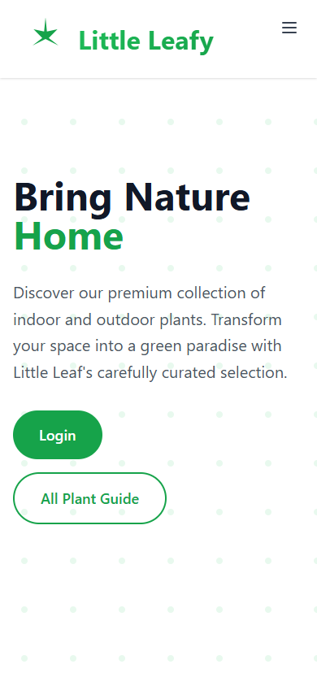

# Little Leafy – Plant Shop Website

A responsive multi-page website for an online plant shop, built as a Web Design & Development (WDD) assignment.

**Live Demo:** https://kaungzawhan830-byte.github.io/little-leafy-plant-website/

## Screenshots

| Desktop | Mobile |
|---|---|
|  |  |

## Features

- 17 pages: Home, Shop, Indoor / Outdoor Plants, Succulents & Cacti, New Arrivals, Premium, Plant Tools, Plant Guide, Plant Detail, Cart, Blog, About, Visit Us, Help, Login and policy pages
- Responsive layout with a mobile menu for phones and tablets
- Product search, image sliders and dropdown navigation

## Technologies

HTML5, CSS3, JavaScript, Tailwind CSS (CDN), Font Awesome

## Run Locally

No build step needed. Download the repository and open `index.html` (or `Home.html`) in any browser.
